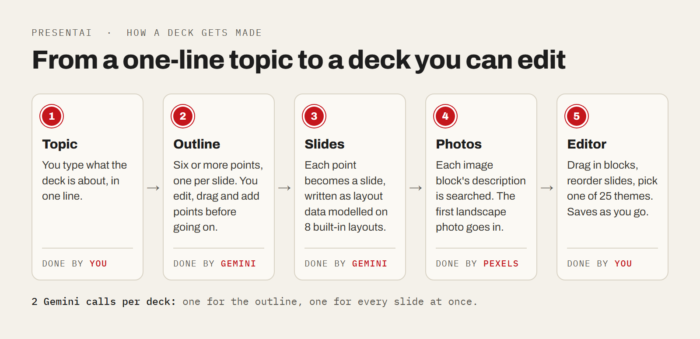

# PresentAI

Type a one-line topic and get a first-draft slide deck with photos, then change anything in a drag-and-drop editor. For anyone who needs slides fast and would rather fix a draft than start from a blank page.



**Stack:** Next.js 15, TypeScript, Tailwind, Zustand, Prisma with Postgres, Clerk login, Gemini 3.6 Flash, Pexels. **Status:** personal project, 2025 to 2026. The AI step has not been re-tested since its Gemini model was updated (see Limits).

## What it does

- Writes an outline of six or more points from your topic. You edit, reorder and add points before any slides are made.
- Turns each point into a slide with a heading, text and, where it fits, a stock photo.
- Lets you edit the deck: drag in layouts and blocks (text, lists, tables, quotes, images), reorder slides, switch between 25 themes. Changes save on their own.
- Plays the deck as a slideshow in the browser.

## How it works

1. **Outline.** One call to Gemini 3.6 Flash returns the outline as JSON (a structured text format).
2. **Slides.** A second Gemini call writes every slide at once as layout JSON: a tree of blocks such as columns, headings, paragraphs and images. The prompt shows it 8 built-in layouts as examples.
3. **Photos.** The code finds each image block and searches Pexels (a free stock photo library) with the block's description.
4. **Editor.** The deck loads into a Zustand store (state the editor's panels share). Edits are saved to Postgres 2 seconds after you stop.

## Run it

```bash
git clone https://github.com/Manveen07/PresentAI
cd PresentAI
npm install --legacy-peer-deps
npx prisma generate
npx prisma db push
npm run dev
```

First create a `.env` file with `DATABASE_URL` (Postgres), `NEXT_PUBLIC_CLERK_PUBLISHABLE_KEY`, `CLERK_SECRET_KEY`, `GEMINI_API_KEY`, `PEXELS_API_KEY` and `NEXT_PUBLIC_HOST_URL=http://localhost:3000`. Payments also need the four `LEMON_SQUEEZY_*` keys.

Making a deck needs a paid account: the app checks the `subscription` flag on your user row. To try it locally, set the flag to true in `npx prisma studio`.

## Limits

- **The AI step is not re-tested.** The code called `gemini-2.0-flash`, which Google [shut down on 1 June 2026](https://ai.google.dev/gemini-api/docs/deprecations). On 25 October 2026 it was switched to `gemini-3.6-flash`, the replacement Google lists, but no deck has been generated since.
- **No export yet.** The landing page mentions PDF and PPTX export, but the code has none.
- **Long decks can fail.** All slides come back in one reply capped at 5,000 tokens. A reply that gets cut off isn't valid JSON, so nothing is saved.
- **Weak photo fallback.** When Pexels finds nothing, which is common for niche topics, the slide gets the same fixed stock photo whatever the topic.
- **Theme changes.** Switching the theme after a deck is made sometimes leaves nested blocks in the old style.
- **Half-built extras.** Share links point to a `/share` page that doesn't exist yet, and the button to buy a deck template is a stub.

Built by [Manveen Singh](https://manveen.me)
